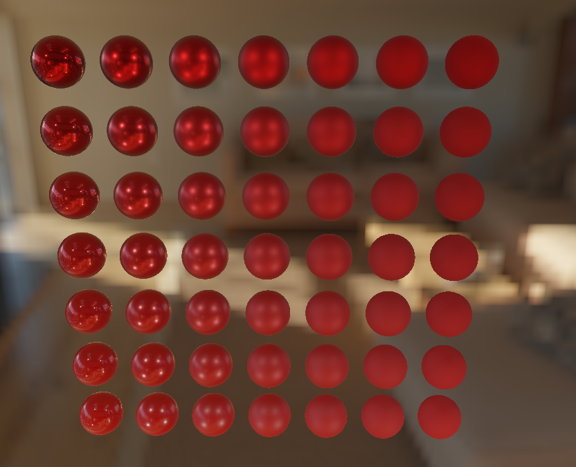

# LearnOpenGL

A from-scratch, cross-platform real-time renderer written in **C++17** and **modern OpenGL 3.3 (core profile)**, built by working through the entire [LearnOpenGL](https://learnopengl.com) curriculum, from a first triangle to physically based rendering with image-based lighting.


<!-- Add a screenshot or short GIF of the PBR sphere demo here, e.g-->



## What this is

The current build renders a **7x7 grid of PBR spheres** (metalness varies down the rows, roughness across the columns) lit by four point lights and an HDR environment map, with a free-fly camera. It is the end point of the PBR chapters and exercises most of the pipeline below: HDR framebuffers, cubemaps, a precomputed IBL pipeline, and GLSL shaders for the Cook-Torrance BRDF.

The repository history is the learning log. Every chapter is its own commit(s), so you can check out an earlier commit to see that technique in isolation (see [Development history](https://github.com/tikitaik/LearnOpenGL/commits/main/)).

## Techniques implemented

| Area | Implemented |
|---|---|
| **Fundamentals** | Shader abstraction, textures, coordinate systems, free-look FPS camera (keyboard, mouse, scroll-zoom) |
| **Lighting** | Blinn-Phong, diffuse/specular light maps, directional / point / spot lights, multiple lights |
| **Model loading** | Assimp integration with `Mesh` / `Model` classes, material and texture loading (repository includes OBJ and glTF assets) |
| **Advanced OpenGL** | Blending and sorted transparency, cubemaps and skybox, instanced rendering (asteroid field), uniform buffer objects for shared camera matrices, geometry shaders (normal visualisation, exploding mesh), framebuffers |
| **Shadows** | Directional shadow mapping, omnidirectional (point-light) shadows rendered to a depth cubemap in a single pass via a geometry shader |
| **Surface detail** | Normal mapping with tangent-space generation, parallax mapping with offset limiting |
| **Colour correctness** | Gamma correction with sRGB texture import, HDR rendering into floating-point framebuffers, tone mapping |
| **Post-processing** | Bloom with separable Gaussian blur |
| **Deferred rendering** | G-buffer pass and lighting pass, SSAO (generation, blur, lighting integration) |
| **PBR** | Cook-Torrance BRDF (GGX distribution, Smith geometry, Fresnel-Schlick), image-based lighting |

### The image-based lighting pipeline

Everything below is computed at startup on the GPU from a single `.hdr` equirectangular image:

1. Equirectangular HDR to environment **cubemap** (512x512 per face)
2. Diffuse **irradiance map** by convolution (32x32 per face)
3. Specular **pre-filtered environment map** with roughness-based mip levels (128x128 base)
4. **BRDF integration LUT** (512x512, RG16F) for the split-sum approximation

## Technical highlights

- **Modular engine-style classes** in `include/`: `Shader` (compiles vertex/fragment and automatically picks up an optional geometry stage), `Mesh`, `Model` (Assimp scene traversal) and `Camera`.
- **Shared camera state via a `std140` uniform block**, so view/projection matrices are uploaded once per frame instead of once per shader.
- **Render-to-texture pipeline**: the scene renders into an `RGBA16F` framebuffer and is resolved to the screen through a full-screen quad pass.
- **Asset path resolution independent of the working directory**, so the executable runs from a terminal or by double-clicking it.
- **Cross-platform build**: a single `CMakeLists.txt` selects bundled libraries for Windows, macOS and Linux, and copies resources and shaders next to the binary. Includes handling for high-DPI framebuffer sizes on macOS.
- Built with `-Wall`, `-Wextra` and a `C++17` requirement.

## Project structure

```
.
├── CMakeLists.txt        Cross-platform build configuration
├── Makefile              Convenience wrapper: configure + build in one command
├── include/              Headers: Shader, Mesh, Model, Camera, plus GLAD, GLM, GLFW, Assimp, stb_image
├── lib/                  Prebuilt GLFW / Assimp libraries per platform (win / mac / linux)
├── resources/
│   ├── objects/          3D models (backpack, planet, rock, sphere, bunny, glTF character)
│   └── textures/         Textures, skybox faces, HDR environment map
└── src/
    ├── main.cpp          Application entry point, scene setup and render loop
    ├── glad/             OpenGL loader
    └── shaders/          One folder per shader program (vertex / fragment / geometry GLSL)
                          e.g. pbr, irradiance, prefilterconv, brdf, shadow, depthmap,
                          gbuffer, ssaolighting, bloom, gaussblur, hdr, skybox, ...
```

## Build and run

### Requirements

- A C++17 compiler (`g++` / MinGW-w64) and **CMake 3.5+**
- A GPU and driver supporting **OpenGL 3.3 core**
- GLFW, GLAD, GLM, stb_image and (on Windows and macOS) Assimp are bundled in the repository.
- **Linux:** install Assimp and the GLFW / X11 / OpenGL development packages from your package manager (for example `libassimp-dev`).

### Quick start

```bash
git clone https://github.com/tikitaik/LearnOpenGL.git
cd LearnOpenGL
make
./build/LearnOpenGL
```

On Windows the `Makefile` uses the `MinGW Makefiles` generator, so run `make` from a MinGW shell (or invoke CMake directly):

```bash
cmake -S . -B build
cmake --build build
```

CMake copies `resources/` and `src/shaders/` into the build directory, so the executable is self-contained there.

## Controls

| Input | Action |
|---|---|
| `W` `A` `S` `D` | Move forward / left / backward / right |
| `Space` / `Left Shift` | Move up / down |
| Mouse | Look around |
| Scroll wheel | Zoom (field of view, not in all builds) |
| `Esc` | Quit |

## Development history

The project was built incrementally over ~110 commits, and the history approximately serves as a chapter-by-chapter record, though multiple commits were often made per chapter. Roughly in order:

coordinate systems, colours, light maps, multiple lights, model loading, blending, cubemaps, instancing, framebuffers, directional shadows, normal mapping, parallax mapping, geometry shaders, deferred rendering, SSAO, PBR and image-based lighting.

To see how a technique was introduced, browse the [commit history](https://github.com/tikitaik/LearnOpenGL/commits/main) and check out the commit for the chapter you're interested in. Later commits add cross-platform fixes (Windows/MinGW and macOS Retina support) and restructure the repository layout.

Once this project was finished, I began creating a [terrain generator](https://github.com/tikitaik/terrain-gen) using OpenGL. The goal of this is to experiment with different terrain generation algorithms and to implement optimisations to increase the performance of the generator.

## Credits

- Curriculum and reference implementation: [LearnOpenGL](https://learnopengl.com) by Joey de Vries. This repository is my own implementation while following the tutorials.
- Libraries: [GLFW](https://www.glfw.org/), [GLAD](https://glad.dav1d.de/), [GLM](https://github.com/g-truc/glm), [stb_image](https://github.com/nothings/stb), [Assimp](https://github.com/assimp/assimp).
- Assets:
  - Backpack model by Berk Gedik ([Sketchfab](https://sketchfab.com/3d-models/survival-guitar-backpack-low-poly-799f8c4511f84fab8c3f12887f7e6b36)), material setup adapted by Joey de Vries.
  - Mars planet model by Gerhald3D ([TurboSquid](https://www.turbosquid.com/3d-models/realistic-mars-photorealistic-2k-3d-1277433)), lightly modified by Joey de Vries.
  - This work is based on "[Shadow The Hedgehog (Free Model)](https://sketchfab.com/3d-models/shadow-the-hedgehog-free-model-bceefa2ec12f4c2080d9522beb9a089a)" by [SonicTeam_12](https://sketchfab.com/sonicteam12), licensed under [CC-BY-4.0](http://creativecommons.org/licenses/by/4.0/).
  - Remaining textures and the HDR environment map are from the LearnOpenGL resources and other freely available sources. See individual attribution files in `resources/objects/`.

## Contact

<!-- Add your name and links, e.g.: -->
**Edward Hirst** · [Portfolio](https://tawai.net/projects) · [LinkedIn](https://linkedin.com/in/ed-hirst) · edthirst@gmail.com 
